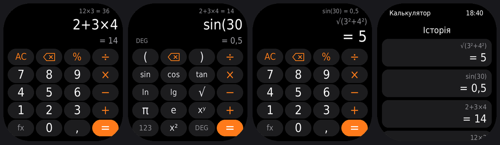

# Калькулятор для Amazfit Bip 6

## Встановлення

Zepp → Профіль → Amazfit Bip 6 → самий низ → «Режим розробника» → кнопка сканування вгорі праворуч → відскануй QR (показати його можна з іншого екрана):

Посилання в QR: `zpkd1://raw.githubusercontent.com/netherm3-coder/bip6-calc/build/bip6-calc.zpk`

## Що вміє

- **Як на Xiaomi**: вираз великим, під ним сірим «= результат», що рахується під час набору. Після «=» навпаки: результат великим, вираз дрібно над ним. Зверху — попереднє обчислення.
- **Пріоритет операцій і дужки**: `2 + 3 × 4 = 14`, `(2 + 3) × 4 = 20`. Незакриті дужки «=» закриває сам.
- **fx** — наукові функції: `( )`, `sin cos tan`, `ln lg`, `√`, `π e`, `xʸ`, `x²`. Після функції клавіатура сама повертається до цифр.
- **DEG / RAD** — клавіша в шарі fx. Коли у виразі є sin, cos чи tan, режим видно ліворуч від результату. У градусах `sin 30 = 0,5`, `cos 90 = 0`, а `tan 90` — «Не визначено».
- **Знак множення можна не ставити**: `2π`, `2(3 + 4)`, `2√9`.
- **Мінус** — та сама клавіша: на початку, після дужки або після × ÷ він стає знаком числа: `5 × −3 = −15`.
- **Відсотки**, як на телефоні: `200 + 15% = 230`, `200 − 15% = 170`, `200 × 15% = 30`, `50% = 0,5`.
- **AC** — очистити все; **⌫** — стерти останнє (у числі — по одній цифрі).
- Після «=» операція продовжує рахунок з результатом, цифра починає новий, а функція (√, sin, x² …) береться від результату.
- **Історія**: торкнись дисплея — останні 30 обчислень. Торкнись запису — результат повернеться в калькулятор. Очистити — двічі натиснути «Очистити історію».
- Набране й історія зберігаються, навіть коли екран гасне й програма закривається (збережене версією 1.0 теж підхоплюється).
- Екран світиться 1 хв від останнього дотику.

## Обмеження

- У числі до 12 цифр; результат — 12 значущих цифр (тому `0,1 + 0,2 = 0,3`, а не `0,30000000000000004`).
- Від 1 000 000 000 000 і менше за 0,000001 — експоненційний запис: `1,5e12` означає 1,5 × 10¹².
- Вираз — до 60 елементів (числа, знаки, дужки, функції).
- Клавіші ± немає: від'ємне число набирається мінусом.
- Якщо в шрифті годинника немає символів `√ π ² −`, замість них буде `sqrt`, `pi`, `^2`, `-`.

## Як це збирається

Після кожного пушу в `main` (і раз на добу) GitHub Actions збирає preview-пакет і кладе його в гілку `build` (`bip6-calc.zpk` — на нього вказує QR). Сканер «Режиму розробника» в Zepp приймає лише preview-пакети.

## Структура

- `page/index.js` — калькулятор (два шари клавіш: цифри й fx)
- `page/history.js` — історія
- `utils/calc.js` — введення, розбір виразу, обчислення, формат чисел
- `utils/store.js` — збереження стану й історії на годиннику
- `utils/ui.js` — підбір розміру тексту, перевірка символів шрифту
- `.tools/build-preview.js` — збірка preview-пакета для QR
